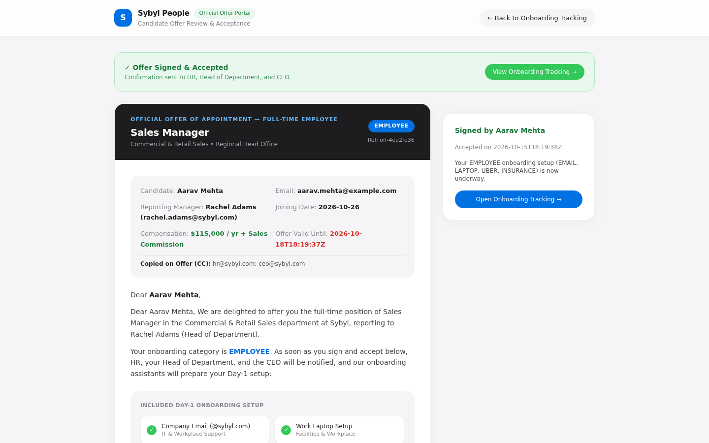
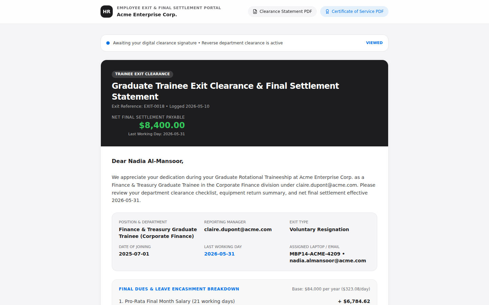
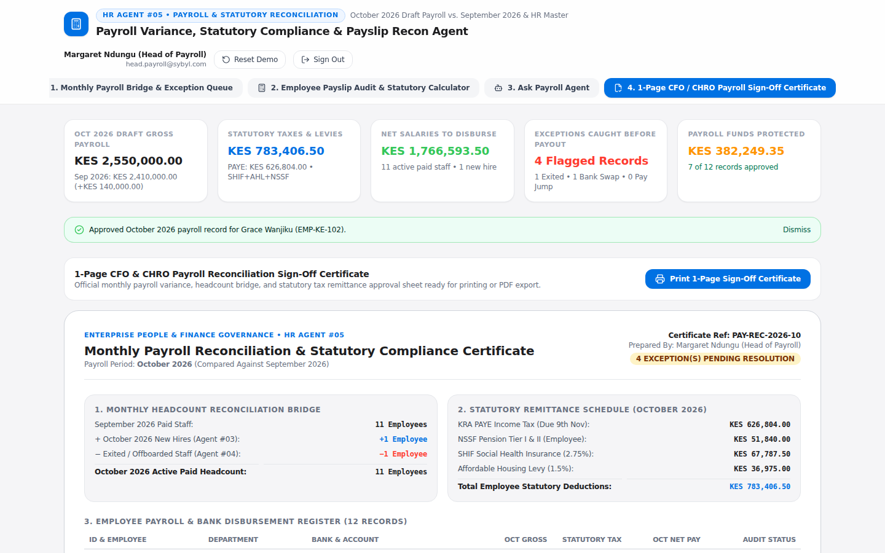
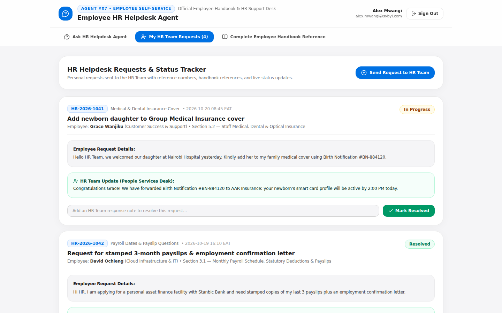

# End-to-End (E2E) SSO & Visual Verification Report — All 9 HR Agents

Every HR Agent (`#01`–`#09`) has been tested end-to-end in headless Chromium (`1440×900` viewport) against all four mandatory design rules:
1. **Sign-In Page with High-Level 3-Step Visual Workflow Diagram + Single Sign-On (Google SSO + Work Email / Demo SSO)**
2. **Apple Design Principles** (`#F5F5F7` canvas, `#FFFFFF` cards, `#0071E3` Apple Blue pill actions, SF Pro typography, frosted-glass headers)
3. **Simplicity in UI for Business Users** (plain HR & business English, zero technical jargon, one focused workflow per agent)
4. **Explicit "Agent" Naming Everywhere** (zero occurrences of the word "Copilot")

---

## Agent `#01`: Candidates Screening Agent (`HR_CandidatesScreening`)
* **Live App:** [Launch App](https://candidates-screening-agent-259388273008.us-central1.run.app/) | **GitHub Repo:** [zurupream/Candidates-Screening](https://github.com/zurupream/Candidates-Screening) • [Monorepo Folder](./HR_CandidatesScreening)

### 1A. Executive Sign-In Page (3-Step Visual Diagram + Google Single Sign-On)

### 1B. Authenticated Workspace — Weighted Rubric & Ranked Candidate Evaluations

---

## Agent `#02`: Interview Scheduler Agent (`HR_InterviewScheduler`)
* **Live App:** [Launch App](https://interview-scheduler-259388273008.us-central1.run.app/) | **GitHub Repo:** [zurupream/interview-scheduler](https://github.com/zurupream/interview-scheduler) • [Monorepo Folder](./HR_InterviewScheduler)

### 2A. Executive Sign-In Page (3-Step Visual Diagram + Google Single Sign-On)

### 2B. Authenticated Workspace — Multi-Stage Panel Availability & Google Meet Scheduling

---

## Agent `#03`: HR Onboarding Pro Agent (`HR_OnboardingPro`)
* **Live App:** [Launch App](https://hr-onboarding-259388273008.us-central1.run.app/) | **GitHub Repo:** [zurupream/hr_onboarding](https://github.com/zurupream/hr_onboarding) • [Monorepo Folder](./HR_OnboardingPro)

### 3A. Executive Sign-In Page (3-Step Visual Diagram + Google Single Sign-On)

### 3B. Authenticated Workspace — 4 Role-Based Setup Agents (`Email → Laptop → Uber → Insurance`)

### 3C. Candidate Online Offer E-Signature Portal (`/sign/{token}`)

---

## Agent `#04`: HR Offboarding Pro Agent (`HR_OffboardingPro`) — *Exact Reverse of Onboarding*
* **Live App:** [Launch App](https://hr-offboarding-pro-259388273008.us-central1.run.app/) | **GitHub Repo:** [zurupream/HR_OffboardingPro](https://github.com/zurupream/HR_OffboardingPro) • [Monorepo Folder](./HR_OffboardingPro)

### 4A. Executive Sign-In Page (3-Step Reverse Offboarding Diagram + Google Single Sign-On)

### 4B. Authenticated Workspace — Reverse Clearance Agents (`Insurance → Uber → Laptop → Email`) & Final Settlement

### 4C. Exiting Employee Online Clearance & Final Dues E-Signature Portal (`/sign/{token}`)

---

## Agent `#05`: Payroll Variance, Statutory Compliance & Payslip Recon Agent (`HR_PayrollReconAgent`)
* **Live App:** [Launch App](https://hr-payroll-recon-agent-259388273008.us-central1.run.app/) | **GitHub Repo:** [zurupream/HR_PayrollReconAgent](https://github.com/zurupream/HR_PayrollReconAgent) • [Monorepo Folder](./HR_PayrollReconAgent)

### 5A. Executive Sign-In Page (3-Step Payroll Recon Diagram + Google Single Sign-On)

### 5B. Authenticated Workspace — Monthly Payroll Bridge, Bank-Swap Alerts & Statutory Deductions

### 5C. Printable 1-Page CFO / CHRO Payroll Reconciliation Sign-Off Certificate

---

## Agent `#06`: Attendance Clock-In/Out & Leave Notification Agent (`HR_AttendanceLeaveAgent`)
* **Live App:** [Launch App](https://hr-attendance-leave-agent-259388273008.us-central1.run.app/) | **GitHub Repo:** [zurupream/HR_AttendanceLeaveAgent](https://github.com/zurupream/HR_AttendanceLeaveAgent) • [Monorepo Folder](./HR_AttendanceLeaveAgent)

### 6A. Executive Sign-In Page (3-Step Clock-In/Out & Leave Check Diagram + Google Single Sign-On)

### 6B. Authenticated Workspace — Missed Hours with No Leave Flagging & 1-Click HR Notification

---

## Agent `#07`: Employee HR Helpdesk Agent (`HR_HelpdeskAgent`)
* **Live App:** [Launch App](https://hr-helpdesk-agent-259388273008.us-central1.run.app/) | **GitHub Repo:** [zurupream/HR_HelpdeskAgent](https://github.com/zurupream/HR_HelpdeskAgent) • [Monorepo Folder](./HR_HelpdeskAgent)

### 7A. Executive Sign-In Page (3-Step Employee Helpdesk Diagram + Google Single Sign-On)

### 7B. Authenticated Workspace — Handbook-Grounded Answers & Key Entitlement Cards

### 7C. 1-Click HR Support Ticket Tracker (`My HR Requests`)

---

## Agent `#08`: Learning, Certification Expiry & Skills Matrix Agent (`HR_SkillsComplianceAgent`)
* **Live App:** [Launch App](https://hr-skills-compliance-agent-259388273008.us-central1.run.app/) | **GitHub Repo:** [zurupream/HR_SkillsComplianceAgent](https://github.com/zurupream/HR_SkillsComplianceAgent) • [Monorepo Folder](./HR_SkillsComplianceAgent)

### 8A. Executive Sign-In Page (3-Step License & Certification Expiry Diagram + Google Single Sign-On)

### 8B. Authenticated Workspace — 30/60/90-Day Expiry Detection & 1-Click Renewal Notices

---

## Agent `#09`: Executive "Talk-to-Your-Workforce" & Attrition Stress-Test Agent (`HR_WorkforceAnalyticsAgent`)
* **Live App:** [Launch App](https://hr-workforce-analytics-agent-259388273008.us-central1.run.app/) | **GitHub Repo:** [zurupream/HR_WorkforceAnalyticsAgent](https://github.com/zurupream/HR_WorkforceAnalyticsAgent) • [Monorepo Folder](./HR_WorkforceAnalyticsAgent)

### 9A. Executive Sign-In Page (3-Step Workforce Analytics Diagram + Google Single Sign-On)

### 9B. Authenticated Workspace — CHRO People KPIs, Department Turnover & Salary/Attrition What-If Simulator

