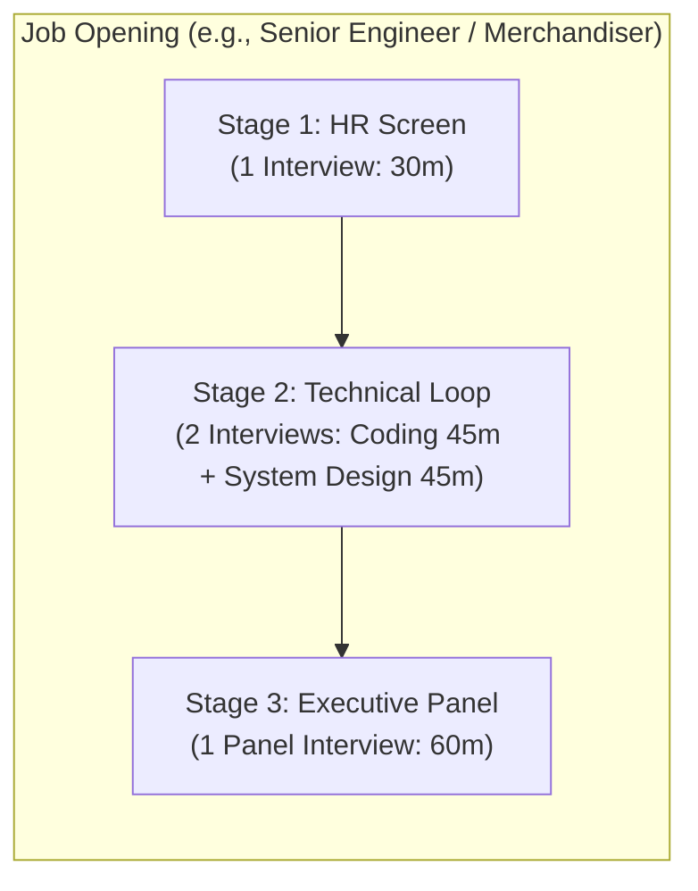
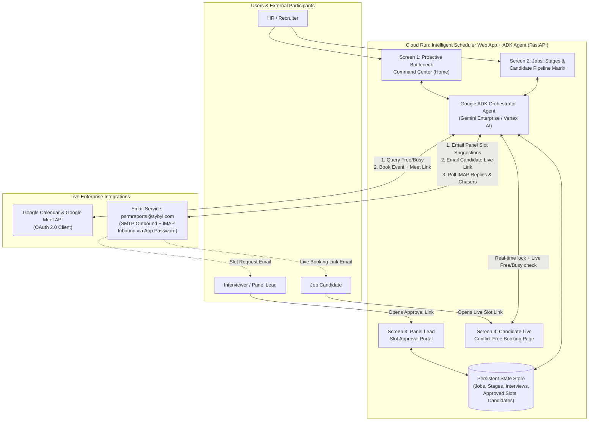

# Intelligent Multi-Stage Interview Scheduler (ADK Agent + Web App)

## 1. Business Challenge

Enterprise recruiting teams manage a high-volume, **4-dimensional scheduling coordination problem**:

$$\text{Many Jobs} \times \text{Many Candidates per Job} \times \text{Multiple Stages per Job} \times \text{Multiple Interviews per Stage}$$

### Why Traditional Scheduling Breaks Down
1. **Calendar Free ≠ Interviewer Ready:** Just because an interviewer's Google Calendar looks free does not mean they want back-to-back interviews all day. Picking slots without confirming capacity with the **Interviewer or Panel Lead** leads to declined invites and last-minute cancellations.
2. **Candidate Slot Collisions (Static Email Problem):** When 10 candidates in the same stage are emailed the same static list of time slots, two or more candidates inevitably reply choosing the exact same slot—causing double-booking frustration and manual back-and-forth emails.
3. **Multi-Stage & Multi-Interview Complexity:** A single stage (e.g., Stage 2 Technical) often requires **multiple distinct interviews** (e.g., Interview 2A: Coding + Interview 2B: System Design) across different interviewers or interviewer pools. Tracking who has finished 1 of 2 vs. 2 of 2 interviews and who is ready to advance to Stage 3 is error-prone.
4. **Hidden Bottlenecks Discovered Too Late:** Recruiters usually realize a hiring pipeline is stalled only *after* candidates complain. Without proactive bottleneck detection (e.g., *"8 candidates waiting in Stage 2, but the panel has only approved 3 slots"*), hiring velocity stalls silently.

---

## 2. Core Functionalities (AI Agent + Web App)

### Functionality 1: AI-Assisted Panel Slot Request & Approval (Interviewer-First)
Instead of blindly offering raw calendar free blocks directly to candidates, the ADK Agent coordinates with the **Interviewer / Panel Lead first**:
- **Demand Calculation:** The Agent counts how many candidates currently need scheduling for a given Job, Stage, and Interview (e.g., *6 candidates pending for Stage 2 — Interview 2A*, requiring at least **8–9 buffer slots**).
- **AI Slot Suggestion via Google Calendar Free/Busy:** The Agent queries Google Calendar (`freeBusy`) across the interview panel/pool to identify optimal conflict-free windows that respect working hours, timezones, and interviewer load limits.
- **Outreach to Interviewer / Panel Lead (`psrmreports@sybyl.com`):** The Agent emails the Interviewer or Panel Lead stating:
  - **How many slots are required** (based on active candidate demand).
  - **AI-suggested free time windows** from their calendar.
  - A **1-click Panel Approval link** (plus natural-language email reply support) so the Panel Lead can confirm, tweak, or add slots in seconds.

### Functionality 2: Live Conflict-Free Candidate Self-Booking Link
To eliminate the race condition where multiple candidates pick the same slot from a static email:
- **Unique Candidate Booking Link:** Once the Panel Lead approves slots, the Agent emails each candidate (via `psrmreports@sybyl.com`) a personalized invitation with a **secure link to the Web App's Live Slot Picker**.
- **Real-Time Slot Availability:** When a candidate opens the link, the Web App dynamically renders **only currently available slots** in the candidate's local timezone—filtering out any slot already claimed by another candidate *and* re-checking live Google Calendar Free/Busy on page load.
- **Atomic Booking & Instant Lock:** The moment Candidate A clicks "Confirm Slot":
  1. The slot is atomically locked so Candidate B viewing the page at the same time sees it disappear immediately.
  2. The Agent re-verifies live Google Calendar availability, creates the Google Calendar event with a **Google Meet** link, and sends calendar invites + confirmation emails to both the candidate and the panel.
- **Multi-Interview Stage Support:** If a stage has multiple interviews (e.g., Interview 2A + Interview 2B), the live booking page guides the candidate to lock in conflict-free times for each required interview in that stage.

### Functionality 3: Multi-Stage & Multi-Interview Pipeline Progression
- **Granular Stage Tracking:** Tracks every candidate across every stage (`Stage 1`, `Stage 2`, `Stage 3`...) and every individual interview within that stage (`Interview 2A: Scheduled`, `Interview 2B: Awaiting Candidate Booking`).
- **Automated Stage Advancement:** When all interviews in Stage $N$ are marked **Completed / Passed**, the Agent automatically moves the candidate to Stage $N+1$, checks if Stage $N+1$ has enough approved panel slots, requests more slots from the Stage $N+1$ Panel Lead if needed, and sends the Stage $N+1$ live booking link to the candidate.

### Functionality 4: Self-Healing Conflict & Reschedule Management
- **Interviewer Cancellation / Decline:** If an assigned interviewer declines a booked calendar invite or becomes unavailable, the Agent first attempts to **hot-swap another approved interviewer from the same stage pool** so the candidate's time slot stays intact. If no swap is available, the Agent notifies the candidate with a fresh live-booking link.
- **Inbox Monitoring (`psrmreports@sybyl.com` via IMAP):** Reads incoming emails from interviewers and candidates, using **Gemini Enterprise** to handle rescheduling requests, panel replies, or special accommodation escalations.

### Functionality 5: Proactive Bottleneck Management & Automated Chasing
- **Automated Supply vs. Demand Monitoring:** Continuously compares **Candidate Demand** (candidates waiting in each stage) against **Approved Panel Slot Supply** (remaining unbooked panel-approved slots).
- **Automated Chasing:** Sends polite reminders (via `psrmreports@sybyl.com`) to Panel Leads who haven't approved requested slots and candidates who haven't booked via their live link within 24–48 hours.
- **Smart Recommendations:** Identifies overloaded interviewers and recommends adding backup interviewers or expanding stage pools before candidates get stuck.

---

## 3. Web Application Screen Flow (Priority-Ordered)

### Screen 1 (Home / Default Landing View): Proactive Bottleneck & Action Command Center
The **first screen** HR and Recruiters see upon opening the Web App is a real-time **Proactive Bottleneck Management Dashboard**:
- **Slot Supply vs. Candidate Demand Alerts:** Highlights stages where candidate demand exceeds approved interviewer slots (e.g., *"🔴 Merchandiser — Stage 2 Technical: 6 candidates waiting, only 2 approved slots available. Deficit: 4+ slots"*), with a **1-Click "AI Request Slots from Panel"** button.
- **Stalled Pipeline & Chasing Queue:**
  - *Panel Bottlenecks:* Interviewers/Panel Leads who haven't responded to AI slot requests (>24h).
  - *Candidate Bottlenecks:* Candidates who received their live booking link but haven't booked (>24h/48h).
  - *Conflict / Escalation Alerts:* Declined calendar invites, zero-slot deadlocks, or candidate accommodation requests requiring human review.
- **AI Autonomous Activity Feed:** Live stream of actions the ADK Agent just completed (slots requested from panels, live bookings confirmed, stages advanced, reminders sent).

### Screen 2: Jobs, Stages & Multi-Interview Pipeline Matrix
- Configure **Jobs**, define **Stages (1..N)**, and configure **Multiple Interviews per Stage** (duration, required panel members, interchangeable interviewer pools, buffer rules).
- Visual **Candidate Pipeline Board** per Job showing each candidate's current stage and per-interview booking status (`Awaiting Panel Slots` → `Booking Link Sent` → `1/2 Booked` → `All Stage Interviews Scheduled` → `Stage Completed`).

### Screen 3: Interviewer / Panel Lead Slot Approval Portal
- Dedicated view (accessible via the link emailed to the Interviewer / Panel Lead) showing:
  - How many candidates are waiting and **how many slots the AI recommends opening**.
  - AI-suggested conflict-free slots pulled from their Google Calendar.
  - One-click checkboxes to approve/deselect suggested slots or add custom windows.

### Screen 4: Candidate Live Self-Booking Portal
- Dedicated conflict-free booking page (accessible via the unique link emailed to the candidate):
  - Displays **live, currently available slots** in the candidate's timezone for all interviews required in their current stage.
  - Prevents double-booking across candidates in real time and immediately books the Google Calendar + Google Meet invite upon confirmation.

### Persistent Sidebar: Embedded ADK Agent Copilot
- Available on every HR screen so recruiters can instruct the agent in natural language (e.g., *"Check which stages have a slot shortage today and email the panel leads"*, *"Advance Amara Okafor to Stage 2"*).

---

## 4. System Architecture

### End-to-End Workflow Summary
1. **Demand & Bottleneck Detection:** A candidate enters **Stage $N$** (which may have 1 or multiple interviews). Screen 1 immediately tracks the slot supply vs. candidate demand for every interview in Stage $N$.
2. **Step 1 — AI Suggests Slots to Interviewer/Panel Lead:** The ADK Agent queries Google Calendar (`freeBusy`) via OAuth, selects optimal open windows, and emails the Interviewer/Panel Lead from `psrmreports@sybyl.com` with the **AI-suggested slots**, the **exact number of slots required**, and a link to **Screen 3 (Panel Approval Portal)** (or they can reply to the email).
3. **Step 2 — Panel Approves → Candidate Gets Live Booking Link:** Once slots are approved, the Agent emails the candidate from `psrmreports@sybyl.com` with a unique link to **Screen 4 (Live Candidate Booking Portal)**.
4. **Step 3 — Live Conflict-Free Selection & Booking:** When the candidate opens the link, the app filters approved slots against live Google Calendar availability and existing bookings so two candidates can **never** pick the same slot. Upon selection, the Agent books the Google Calendar event with a **Google Meet** link and sends confirmations.
5. **Step 4 — Multi-Interview Completion & Stage Advancement:** Once all interviews in Stage $N$ are completed and passed, the Agent automatically advances the candidate to Stage $N+1$ and repeats the cycle, while surfacing any bottlenecks or unresponsive participants on **Screen 1**.

### Technology Stack & Credentials
- **AI Agent Framework:** Google Agent Development Kit (`google-adk`) powered by **Gemini Enterprise on Vertex AI** (`GOOGLE_GENAI_USE_VERTEXAI=1`, Project: `gemini-enterprise-demo-498212`).
- **Web Application & API:** FastAPI + Modern Responsive Frontend (HTML/Tailwind/JS), packaged for **Google Cloud Run**.
- **Calendar & Video Conferencing:** Google Calendar API v3 (`freeBusy` queries + Event creation with `conferenceData` for real Google Meet links) using the configured Google OAuth Client.
- **Email Communication:** `psrmreports@sybyl.com` using App Password over **SMTP** (sending panel slot requests, candidate live booking links, confirmations, and reminders) and **IMAP** (reading replies and escalations).
