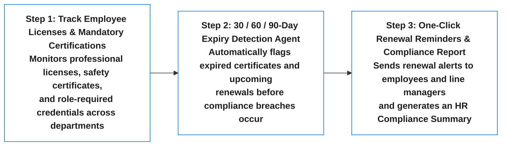

# Agent #08: Learning, Certification Expiry & Skills Matrix Agent (`HR_SkillsComplianceAgent`)

An Apple-inspired, executive-grade HR & People Compliance Agent that tracks mandatory employee licenses, safety certifications, regulatory credentials, and training bonds across departments—automatically detecting 30 / 60 / 90-day expirations and dispatching one-click renewal notices to employees and their line managers.

---

## 1. High-Level 3-Step Visual Workflow Diagram



---

## 2. Core Features & Business Design Principles

1. **Executive Sign-In Page + Single Sign-On (SSO):**
   - Left panel displays the **3-Step Visual Workflow Diagram**.
   - Right panel provides **Google Single Sign-On (SSO)** (`/api/auth/google`), **Work Email OTP Verification** (`/api/auth/otp/request` & `/api/auth/otp/verify`), and a 1-click **"Instant Demo Sign-In (L&D and Compliance Lead)"** (`/api/auth/demo`).
2. **Apple Design Principles:**
   - Clean `#F5F5F7` canvas, `#FFFFFF` cards, `#0071E3` Apple Blue primary actions, SF Pro typography, frosted-glass header, and four clear status badges:
     - `Active & Valid`
     - `Expiring in 30 Days`
     - `Expiring in 60–90 Days`
     - `Expired — Action Required`
3. **Zero Technical Jargon for HR & Business Leaders:**
   - **5 Top KPI Cards:** Total Tracked Certifications, Valid & Compliant, Expiring Within 30 Days, Expired (Immediate Renewal Needed), and Reminders Sent.
   - **Certification & License Tracker Table:** Employee Name, Role & Department, Certificate / License Name (plus active training bond balance), Issuing Body, Expiry Date, Days Remaining, Status Badge, and 1-click **Send Renewal Notice** (plus bulk reminder dispatch).
   - **Role Skills & Certification Matrix:** Required vs. completed certifications and compliance rate by department.
   - **Ask Certification Agent:** Plain-English conversational compliance Q&A assistant.
   - **Printable 1-Page Certification Compliance Audit Report:** Web print view plus downloadable PDF (`/api/audit-report/pdf`) and CSV export (`/api/audit-report/csv`).

---

## 3. Quick Start & Running Tests

```bash
# Install dependencies
pip install -r requirements.txt

# Run pytest verification suite
pytest -v

# Start the FastAPI server
uvicorn app.main:app --host 0.0.0.0 --port 8008
```
