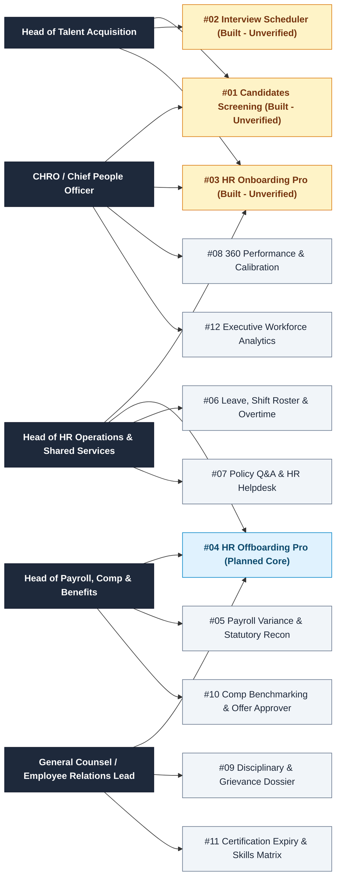
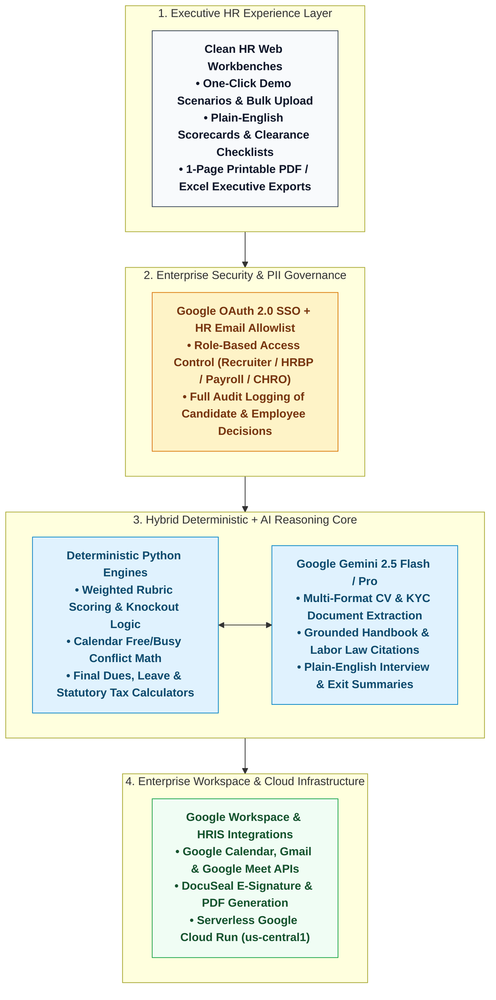

# Enterprise HR AI Agent Portfolio & Executive Catalog

This repository serves as the central catalog and executive showcase for the **12-Agent Enterprise Human Resources (HR) & People Operations AI Portfolio** (`#01`–`#12`).

Built specifically for **Chief Human Resources Officers (CHROs), Heads of Talent Acquisition, HR Business Partners (HRBPs), Payroll & Compensation Leaders, and General Counsel / Employee Relations Teams**, every agent in this portfolio is designed around five enterprise principles:
1. **Plain HR & Business English** — Zero engineering jargon or raw JSON payloads in the user interface; outputs read like board-grade HR dossiers, shortlist scorecards, and statutory compliance memos.
2. **Executive Scannability** — Clean, high-contrast workspaces that surface candidate fit scores, onboarding blockers, clearance checklists, and payroll anomalies at a glance.
3. **Enterprise SSO & Role-Based Governance** — Google OAuth 2.0 authentication with strict email allowlisting and audit trails for sensitive employee PII and compensation data.
4. **Deterministic Python Math + Explainable AI Reasoning** — Weighted rubric math, pro-rata final dues, statutory tax/deduction formulas (PAYE, NSSF, SHIF/NHIF, Housing Levy), and calendar slot conflict checks are computed 100% deterministically in Python, while Google Gemini handles multi-format document extraction, policy citation, and executive narratives.
5. **100% Human-in-the-Loop (HITL) Decision Control** — AI agents screen, coordinate, reconcile, and draft, while HR leaders retain final authority over hiring, offers, disciplinary actions, and offboarding sign-off.

---

## 1. Master Portfolio Table (All 12 HR Agents)

> **Build & Verification Legend:**
> - **🟡 Built (Unverified)** — End-to-end codebase and core workflows are built (`#01`–`#03`); pending final end-to-end UAT verification and production sign-off.
> - **⚪ Planned (Core Roadmap)** — Specified in the core HR lifecycle roadmap (`#04`), next in the build queue.
> - **💡 Proposed HR Function Idea** — High-ROI expansion agents (`#05`–`#12`) across Payroll, Time & Attendance, Policy Helpdesk, Performance, Employee Relations, Compensation, L&D, and People Analytics.

| # | HR Agent | Capabilities & HR Workflow | Business Value for CHRO & People Teams | Build / Verification Status | GitHub Repository & Local Workspace |
| :--- | :--- | :--- | :--- | :--- | :--- |
| **#01** | **Candidates Screening Agent** (`Candidates-Screening`) | Generates structured evaluation rubrics directly from a Job Description, parses bulk candidate CVs/resumes (PDF/DOCX), checks mandatory knockout criteria, computes weighted skill/experience scores, and exports a ranked shortlist (`screening_results.xlsx`) with plain-English hiring rationales. | Cuts first-round CV screening time by **85%+**, eliminates reviewer fatigue, and ensures every applicant is evaluated against an objective, auditable rubric. | **🟡 Built — Unverified** [Live Cloud Run Preview](https://candidates-screening-agent-z2hhdear5q-uc.a.run.app) | [zurupream/Candidates-Screening](https://github.com/zurupream/Candidates-Screening) (`/home/ubuntu/candidates_screening`) |
| **#02** | **Interview Scheduler Agent** (`interview-scheduler`) | Coordinates multi-stage interview panels (`Screening -> Technical -> Executive`) by checking real-time interviewer free/busy slots via Google Calendar API, proposing conflict-free windows to candidates via Gmail, auto-booking Google Meet links, sending reminders, and escalating unresponsive candidates. | Eliminates **5–10 back-and-forth scheduling emails per candidate**, accelerates Time-to-Hire, and prevents double-booked interview panels. | **🟡 Built — Unverified** *(48 unit tests passing; pending live UAT verification)* | [zurupream/interview-scheduler](https://github.com/zurupream/interview-scheduler) (`/home/ubuntu/interview-scheduler`) |
| **#03** | **HR Onboarding Pro** (`hr_onboarding`) | Automates the post-selection **Offer-to-Day-One** pipeline: generates branded Offer Letter PDFs, tracks e-signatures (`OfferESignAgent` / DocuSeal), collects statutory KYC documents (ID, Tax/KRA PIN, NSSF, SHIF, Bank Details), triggers IT laptop/SSO provisioning, and tracks multi-day onboarding milestones. | Prevents pre-Day-One candidate drop-off, ensures **100% statutory file completeness** before payroll cut-off, and gives new hires a seamless Day-One experience. | **🟡 Built — Unverified** [Live Cloud Run Preview](https://hr-onboarding-z2hhdear5q-uc.a.run.app) | [zurupream/hr_onboarding](https://github.com/zurupream/hr_onboarding) (`/home/ubuntu/hr_onboarding`) |
| **#04** | **HR Offboarding Pro** (`HR_OffboardingPro`) | Orchestrates structured employee exits (resignation, retirement, or termination): launches multi-department clearance workflows (IT SSO/access revocation, laptop/asset return, Finance loan/advance recovery), synthesizes exit interview themes, calculates deterministic **Final Dues** (pro-rata pay, accrued leave encashment, notice pay, statutory taxes), and generates the **Certificate of Service**. | Closes security and data-leak gaps from lingering IT access, prevents payroll overpayment or unrecovered staff loans, and produces legally compliant exit documentation in minutes. | **⚪ Planned — Not Yet Built** *(Next Core Build)* | *Planned Repository:* `zurupream/HR_OffboardingPro` |
| **#05** | **Payroll Variance, Statutory Compliance & Payslip Recon Agent** (`HR_PayrollReconAgent`) | Reconciles current-month draft payroll against prior-month payroll and HRIS master data; flags headcount changes, unexplained basic pay jumps, overtime spikes, bank-account changes, and ghost-worker risks; verifies deterministic PAYE, NSSF, SHIF/NHIF, and Housing Levy calculations. | Catches payroll errors and fraudulent bank account swaps **before** salary disbursement, reducing monthly payroll sign-off time from days to 15 minutes. | **💡 Proposed HR Function Idea** *(Payroll & Compliance)* | *Roadmap Concept* |
| **#06** | **Leave, Shift Roster & Overtime Compliance Agent** (`HR_LeaveOvertimeAgent`) | Cross-checks employee leave requests and biometric/clock-in attendance logs against shift rosters, department minimum-staffing rules, annual leave carryover limits, and overtime pre-approval policies; flags unapproved overtime claims and understaffed shifts. | Stops overtime leakage, prevents critical shift coverage gaps across branches/plants, and automates leave liability tracking for Finance. | **💡 Proposed HR Function Idea** *(HR Operations & Time)* | *Roadmap Concept* |
| **#07** | **Employee Policy Q&A, Handbook Redline & HR Helpdesk Agent** (`HR_PolicyHelpdeskAgent`) | Instant 24/7 employee self-service assistant grounded strictly in the company Employee Handbook, CBA, and national Employment Act; answers policy questions with exact section citations, generates standard HR letters (visa/embassy, bank employment proof), and redlines policy updates against labor law changes. | Deflects **70%+ of repetitive tier-1 HR helpdesk tickets** and ensures every policy answer and employment verification letter is consistent and compliant. | **💡 Proposed HR Function Idea** *(HR Shared Services)* | *Roadmap Concept* |
| **#08** | **Performance Review (360°), KPI Calibration & PIP Drafting Agent** (`HR_PerformanceCalibrationAgent`) | Synthesizes self-assessments, manager evaluations, 360° peer feedback, and quantitative KPI attainment into balanced appraisal summaries; detects manager rating inflation/bias across departments; drafts structured Individual Development Plans (IDPs) or legally defensible Performance Improvement Plans (PIPs). | Saves managers hours during appraisal cycles, enforces fair cross-department calibration, and structures clear, measurable PIP milestones. | **💡 Proposed HR Function Idea** *(Talent Management)* | *Roadmap Concept* |
| **#09** | **Employee Relations, Disciplinary & Grievance Case Dossier Agent** (`HR_EmployeeRelationsAgent`) | Guides HRBPs through disciplinary and grievance cases step by step; verifies procedural fairness against the Employment Act and internal Disciplinary Code (Notice to Show Cause, invitation to hearing, right to representation, hearing minutes, warning/termination letters) and builds a chronological case dossier. | Protects the enterprise against **unfair termination lawsuits and labor tribunal penalties** caused by procedural missteps. | **💡 Proposed HR Function Idea** *(Employee Relations & Legal)* | *Roadmap Concept* |
| **#10** | **Compensation Benchmarking, Job Grading & Offer Approver Agent** (`HR_CompBenchmarkAgent`) | Evaluates proposed new-hire offers, promotions, and salary adjustments against internal job grades, salary band quartiles, market survey benchmarks, internal peer pay-equity ratios, and approved department headcount budgets; produces a 1-Page Comp Committee Approval Memo. | Prevents salary band compression, enforces internal pay equity across gender and tenure, and stops unbudgeted offer creep. | **💡 Proposed HR Function Idea** *(Total Rewards & Comp)* | *Roadmap Concept* |
| **#11** | **Learning, Certification Expiry & Skills Matrix Agent** (`HR_SkillsComplianceAgent`) | Tracks mandatory professional licenses, safety certifications, regulatory CPD hours, and staff training bonds; alerts HR and line managers 30/60/90 days before credential expiry and maps employee skill gaps to targeted training curricula. | Eliminates regulatory compliance breaches from expired staff licenses and protects training ROI through automated training-bond tracking. | **💡 Proposed HR Function Idea** *(Learning & Development)* | *Roadmap Concept* |
| **#12** | **Executive "Talk-to-Your-Workforce" & Attrition Stress-Test Agent** (`HR_WorkforceAnalyticsAgent`) | Conversational People Analytics studio for the CHRO and CEO: ask plain-English questions across headcount, regrettable attrition, time-to-fill, diversity ratios, span of control, and wage-bill trends, plus interactive sliders to stress-test salary review increments, restructuring costs, or turnover spikes. | Replaces static monthly HR slide decks with live, boardroom-ready workforce intelligence and instant wage-bill scenario modeling. | **💡 Proposed HR Function Idea** *(Executive People Analytics)* | *Roadmap Concept* |

---

## 2. Which Agent to Prioritise by HR & Executive Role

Use the routing map below to match each HR stakeholder to the highest-impact agents in the portfolio:

---

## 3. Connected Multi-Agent Spotlight: End-to-End Hire-to-Retire Lifecycle (`#01` → `#02` → `#03` → `#04`)

Your first four core agents form a seamless **End-to-End Employee Lifecycle Pipeline** where the structured output of each agent feeds the next stage without manual re-keying:

```mermaid
flowchart LR
    classDef stage1 fill:#fef3c7,stroke:#d97706,color:#78350f,font-weight:bold
    classDef stage2 fill:#fef3c7,stroke:#d97706,color:#78350f,font-weight:bold
    classDef stage3 fill:#fef3c7,stroke:#d97706,color:#78350f,font-weight:bold
    classDef stage4 fill:#e0f2fe,stroke:#0284c7,color:#0c4a6e,font-weight:bold

    subgraph S1["Stage 1: Source & Shortlist (Built - Unverified)"]
        A1["#01 Candidates Screening<br>• Parses JD into Weighted Rubric<br>• Scores Bulk PDF/DOCX CVs<br>• Exports Top Shortlist"]:::stage1
    end

    subgraph S2["Stage 2: Coordinate & Interview (Built - Unverified)"]
        A2["#02 Interview Scheduler<br>• Reads Google Calendar Free/Busy<br>• Emails Slot Proposals via Gmail<br>• Books Multi-Stage Google Meet"]:::stage2
    end

    subgraph S3["Stage 3: Offer & Onboard (Built - Unverified)"]
        A3["#03 HR Onboarding Pro<br>• Generates Offer PDF & E-Sign<br>• Collects KYC, Tax & Bank Docs<br>• Triggers IT Provisioning"]:::stage3
    end

    subgraph S4["Stage 4: Clear & Offboard (Planned Next)"]
        A4["#04 HR Offboarding Pro<br>• IT Access & Asset Clearance<br>• Exit Interview Synthesis<br>• Final Dues & Certificate of Service"]:::stage4
    end

    A1 -->|"Approved Shortlist<br>(Candidate Emails & Scores)"| A2
    A2 -->|"Selected Finalist<br>(Confirmed Hire Decision)"| A3
    A3 -->|"Active Employee Record<br>(Contract, Assets & Benefits)"| A4
```

---

## 4. Core HR Agent Walkthroughs (`#01`–`#04`) & Functional Expansion Concepts (`#05`–`#12`)

### `#01` Candidates Screening Agent (`Candidates-Screening`) — *Built (Pending Final Verification)*
* **Repository:** [zurupream/Candidates-Screening](https://github.com/zurupream/Candidates-Screening) | **Local Path:** `/home/ubuntu/candidates_screening`
* **Live Service:** [https://candidates-screening-agent-z2hhdear5q-uc.a.run.app](https://candidates-screening-agent-z2hhdear5q-uc.a.run.app)
* **90-Second Demo Flow:**
  1. Paste or upload a **Job Description** (or load a sample role) and click **Generate Rubric** — watch the agent extract weighted evaluation criteria and mandatory knockout requirements.
  2. Adjust criterion weights if desired, then upload a batch of **Candidate CVs (PDF/DOCX)**.
  3. Inspect the **Ranked Candidate Leaderboard** with per-criterion scores, knockout flags, plain-English strengths/gaps, and one-click **Excel Shortlist Export (`screening_results.xlsx`)**.
* **Verification Checklist Before Production Sign-Off:**
  - [ ] Verify end-to-end Google OAuth login & allowlist enforcement on Cloud Run.
  - [ ] Run a 10-CV mixed batch (PDF + DOCX) and confirm Excel export download formatting.

---

### `#02` Interview Scheduler Agent (`interview-scheduler`) — *Built (Pending Final Verification)*
* **Repository:** [zurupream/interview-scheduler](https://github.com/zurupream/interview-scheduler) | **Local Path:** `/home/ubuntu/interview-scheduler`
* **90-Second Demo Flow:**
  1. Open the **Interview Scheduler Console** (`scheduler/webapp.py`), select a shortlisted candidate and a multi-stage interview template (`Screening -> Technical -> Culture Fit`).
  2. The agent queries interviewer availability via **Google Calendar API**, identifies conflict-free time windows across the panel, and dispatches slot options to the candidate via **Gmail API**.
  3. Once the candidate selects a slot, the agent books the **Google Meet** calendar event for all panelists, tracks stage progression (`scheduler/multistage.py`), and automatically follows up with unresponsive candidates.
* **Verification Checklist Before Production Sign-Off:**
  - [ ] Deploy the latest `main` branch (`86e42af`, 48 passing unit tests) to Cloud Run with live Google Calendar & Gmail OAuth credentials.
  - [ ] Verify live calendar event creation, Google Meet link generation, and multi-stage advancement.

---

### `#03` HR Onboarding Pro (`hr_onboarding`) — *Built (Pending Final Verification)*
* **Repository:** [zurupream/hr_onboarding](https://github.com/zurupream/hr_onboarding) | **Local Path:** `/home/ubuntu/hr_onboarding`
* **Live Service:** [https://hr-onboarding-z2hhdear5q-uc.a.run.app](https://hr-onboarding-z2hhdear5q-uc.a.run.app)
* **90-Second Demo Flow:**
  1. Launch a single or batch new-hire onboarding workflow with candidate role, compensation, and start date.
  2. **Offer & E-Signature (`OfferESignAgent`):** Generates a formatted Offer Letter PDF, dispatches the signing link, and processes the signature webhook.
  3. **Pre-Day-One Orchestration (`OnboardingOrchestrator`):** Tracks statutory KYC document uploads (National ID, KRA PIN, NSSF, SHIF, Bank Details), dispatches IT hardware & email provisioning tasks, and monitors Day-One readiness on the HR status dashboard.
* **Verification Checklist Before Production Sign-Off:**
  - [ ] Verify live Offer PDF generation, `/sign` e-signature flow, and webhook state transition on Cloud Run.
  - [ ] Confirm end-to-end multi-day milestone reminders and HR status dashboard updates.

---

### `#04` HR Offboarding Pro (`HR_OffboardingPro`) — *Not Yet Built (Next Core Build)*
* **Planned Capabilities & Architecture:**
  1. **Exit Intake & Timeline Engine:** Accepts resignation letter or termination notice, calculates notice period end date, last working day, and statutory clearance deadlines.
  2. **Multi-Department Clearance Orchestrator:**
     - **IT & Security:** Revokes SSO, email, ERP/CRM, and GitHub access; tracks laptop, phone, and badge physical handover.
     - **Finance & Payroll:** Checks outstanding staff loans, salary advances, unretired imprest/float, and corporate card balances.
     - **Line Manager & HR:** Tracks knowledge-transfer handover notes and conducts structured AI-assisted exit interview synthesis.
  3. **Deterministic Final Dues Calculator (Python):** Computes pro-rata salary for days worked, accrued untaken leave encashment, notice pay (or payment in lieu of notice), severance/service pay where applicable, less statutory taxes (PAYE, NSSF, SHIF, Housing Levy) and verified company recoveries.
  4. **1-Page Exit Pack Generator:** Produces a print-ready **Final Dues Statement**, **Multi-Department Clearance Sign-Off Sheet**, and statutory **Certificate of Service**.

---

### `#05`–`#12` Functional HR Expansion Ideas (Summary Blueprint)

* **`#05` Payroll Variance, Statutory Compliance & Payslip Recon Agent (`HR_PayrollReconAgent`):** Deterministic month-over-month payroll bridge (joiners, leavers, promotions, overtime, deductions) + statutory tax formula audit + bank-account-change fraud alert before CFO/CHRO payroll approval.
* **`#06` Leave, Shift Roster & Overtime Compliance Agent (`HR_LeaveOvertimeAgent`):** Reconciles biometric clock-ins against shift rosters and approved overtime requests; prevents understaffed shifts and unbudgeted overtime leakage.
* **`#07` Employee Policy Q&A, Handbook Redline & HR Helpdesk Agent (`HR_PolicyHelpdeskAgent`):** Citation-backed employee self-service policy bot + automated employment proof letters + labor law handbook redliner.
* **`#08` Performance Review (360°), KPI Calibration & PIP Drafting Agent (`HR_PerformanceCalibrationAgent`):** Synthesizes 360° feedback and KPI scores, highlights cross-manager rating bias during calibration committees, and drafts structured IDPs/PIPs.
* **`#09` Employee Relations, Disciplinary & Grievance Case Dossier Agent (`HR_EmployeeRelationsAgent`):** Procedural compliance guardrail for show-cause notices, disciplinary hearings, and grievance investigations under national labor law.
* **`#10` Compensation Benchmarking, Job Grading & Offer Approver Agent (`HR_CompBenchmarkAgent`):** Compares proposed offers and increments against internal salary bands, peer pay equity, and department budgets.
* **`#11` Learning, Certification Expiry & Skills Matrix Agent (`HR_SkillsComplianceAgent`):** Tracks mandatory professional licenses, safety certificates, CPD hours, and staff training bonds with 30/60/90-day expiry alerts.
* **`#12` Executive "Talk-to-Your-Workforce" & Attrition Stress-Test Agent (`HR_WorkforceAnalyticsAgent`):** Conversational CHRO/CEO analytics across headcount, attrition, diversity, and interactive wage-bill scenario sliders.

---

## 5. Reference Enterprise HR Agent Architecture

All HR agents in this portfolio follow a standardized, auditable 4-layer architecture:

