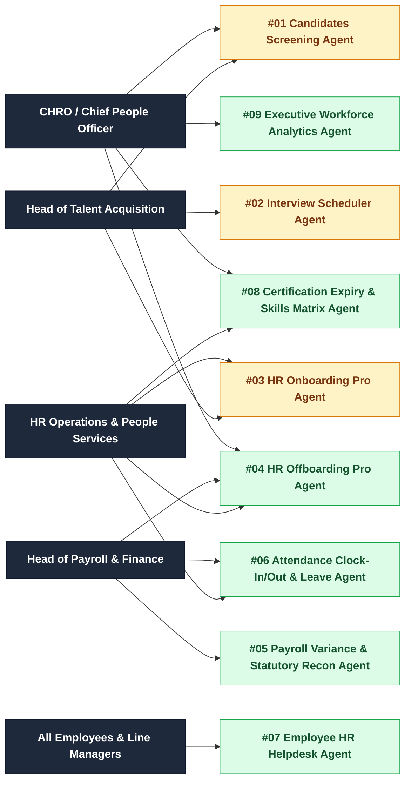
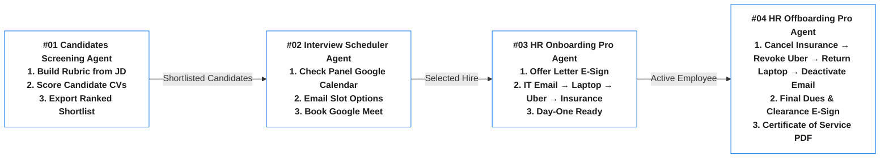

# Enterprise HR AI Agent Portfolio & Executive Catalog

This repository serves as the central catalog and executive showcase for the **9-Agent Enterprise Human Resources (HR) & People Operations AI Portfolio** (`#01`–`#09`).

Built specifically for **Chief Human Resources Officers (CHROs), Heads of Talent Acquisition, HR Operations Teams, Payroll Leaders, and Employees**, every agent in this portfolio is built around five core principles:
1. **One Focused Job Per Agent** — Each agent solves one high-impact HR workflow exceptionally well without mixing unrelated tasks.
2. **Apple Design Principles & Business Simplicity** — Clean `#F5F5F7` surfaces, high-contrast cards, clear typography, and plain business English with zero technical jargon.
3. **Sign-In Page with High-Level Workflow Diagram + Single Sign-On (SSO)** — Every agent opens with an executive sign-in page illustrating its 3-step workflow diagram alongside Google Single Sign-On (SSO).
4. **Deterministic Python Math + Focused AI Reasoning** — Hours worked, leave balances, payroll tax formulas (PAYE, NSSF, SHIF/NHIF, Housing Levy), and final settlement math are calculated 100% deterministically in Python, while AI handles document reading, policy answers, and plain-English summaries.
5. **100% Human-in-the-Loop (HITL) Control** — AI agents screen, verify, reconcile, and assist, while HR leaders make every final decision.

---

## 1. Master Portfolio Table (All 9 Approved HR Agents)

| # | HR Agent | Focused Capability & HR Workflow | Business Value for HR & People Teams | Build Status & Live Link | GitHub Repository & Folder |
| :--- | :--- | :--- | :--- | :--- | :--- |
| **#01** | **Candidates Screening Agent** (`Candidates-Screening`) | Generates a structured evaluation rubric from a Job Description, reads bulk candidate CVs (PDF/DOCX), checks mandatory criteria, scores each applicant, and exports a ranked Excel shortlist (`screening_results.xlsx`). | Cuts first-round CV screening time by **85%+** and evaluates every applicant against the same objective standard. | **🟡 Built — Pending Verification** [Live Cloud Run App](https://candidates-screening-agent-z2hhdear5q-uc.a.run.app) | [zurupream/Candidates-Screening](https://github.com/zurupream/Candidates-Screening) (`/home/ubuntu/candidates_screening`) |
| **#02** | **Interview Scheduler Agent** (`interview-scheduler`) | Coordinates multi-stage interview panels (`Screening → Technical → Final`) by checking interviewer availability on Google Calendar, sending time-slot options to candidates via Gmail, and booking Google Meet links automatically. | Eliminates **5–10 scheduling emails per candidate** and prevents double-booked interview panels. | **🟡 Built — Pending Verification** | [zurupream/interview-scheduler](https://github.com/zurupream/interview-scheduler) (`/home/ubuntu/interview-scheduler`) |
| **#03** | **HR Onboarding Pro Agent** (`hr_onboarding`) | Automates the post-offer onboarding journey: generates Offer Letter PDFs, captures online e-signatures (`/sign`), and coordinates 4 role-based setup agents: `1. IT Email Setup` → `2. Laptop Request` → `3. Uber Commute Pass` → `4. Health Insurance`. | Prevents pre-Day-One candidate drop-off and ensures every new hire has their email, laptop, transport pass, and medical cover ready on Day 1. | **🟡 Built — Pending Verification** [Live Cloud Run App](https://hr-onboarding-z2hhdear5q-uc.a.run.app) | [zurupream/hr_onboarding](https://github.com/zurupream/hr_onboarding) (`/home/ubuntu/hr_onboarding`) |
| **#04** | **HR Offboarding Pro Agent** (`HR_OffboardingPro`) | Executes the **exact reverse steps of Onboarding**: logs the exit notice, runs reverse clearance agents (`1. Health Insurance Cancellation` → `2. Uber Pass Revocation` → `3. Laptop Return & Inspection` → `4. IT Email & SSO Deactivation`), calculates Final Dues, captures employee clearance sign-off, and issues the Certificate of Service PDF. | Closes security gaps from active accounts after exit, ensures company laptops are returned before final payout, and produces instant exit documentation. | **🔨 In Active Build** *(Subagent Building)* | `HR_Agents/HR_OffboardingPro` (`/home/ubuntu/hr_offboarding`) |
| **#05** | **Payroll Variance, Statutory Compliance & Payslip Recon Agent** (`HR_PayrollReconAgent`) | Compares current-month draft payroll against last month's payroll and HR master records; flags headcount changes, unexplained pay jumps, bank-account swaps, and ghost-worker risks; verifies statutory deductions (PAYE, NSSF, SHIF, Housing Levy). | Catches payroll calculation errors and unauthorized bank account changes **before** salaries are paid out. | **🔨 Approved — Building Now** | `HR_Agents/HR_PayrollReconAgent` |
| **#06** | **Attendance Clock-In/Out & Leave Notification Agent** (`HR_AttendanceLeaveAgent`) | Checks the attendance system clock-in and clock-out times against approved leave applications, calculates exact hours worked vs. required shift hours, and notifies HR for each employee who missed hours or was absent with no leave application. | Gives HR an instant daily exception list of employees with missing hours or unapproved absences without manually cross-checking spreadsheets. | **🔨 Approved — Building Now** | `HR_Agents/HR_AttendanceLeaveAgent` |
| **#07** | **Employee HR Helpdesk Agent** (`HR_HelpdeskAgent`) | A simple, focused employee self-service HR Helpdesk Agent that answers everyday staff questions (annual/sick leave rules, medical cover benefits, payroll dates, expense claims, office guidelines) using the official Employee Handbook and creates an HR support ticket when human follow-up is needed. | Resolves **70%+ of routine employee HR questions** immediately so HR teams can focus on high-priority people matters. | **🔨 Approved — Building Now** | `HR_Agents/HR_HelpdeskAgent` |
| **#08** | **Learning, Certification Expiry & Skills Matrix Agent** (`HR_SkillsComplianceAgent`) | Tracks mandatory professional licenses, safety certifications, regulatory training hours, and staff training bonds; alerts HR and line managers 30, 60, and 90 days before any employee certificate expires. | Prevents compliance breaches from expired staff licenses and gives HR a clear view of team certifications. | **🔨 Approved — Building Now** | `HR_Agents/HR_SkillsComplianceAgent` |
| **#09** | **Executive "Talk-to-Your-Workforce" & Attrition Stress-Test Agent** (`HR_WorkforceAnalyticsAgent`) | Plain-English workforce analytics workspace for the CHRO and CEO covering headcount, department turnover, hiring speed, and interactive sliders to test the budget impact of salary reviews or attrition changes. | Replaces static monthly HR spreadsheets with instant answers and live wage-bill scenario planning. | **🔨 Approved — Building Now** | `HR_Agents/HR_WorkforceAnalyticsAgent` |

---

## 2. Which Agent to Demo by HR & Executive Role

---

## 3. Connected Multi-Agent Spotlight: End-to-End Hire-to-Retire Pipeline (`#01` → `#02` → `#03` → `#04`)

The first four agents connect seamlessly across the employee journey—and `#04 HR Offboarding Pro Agent` executes the exact reverse provisioning steps of `#03 HR Onboarding Pro Agent`:

---

## 4. 90-Second Demo Walkthroughs (All 9 Agents)

### `#01` Candidates Screening Agent (`Candidates-Screening`)
1. **Sign In & Select Role:** Sign in via Google SSO and paste a Job Description (or load a sample role) to generate a weighted evaluation rubric.
2. **Upload Candidate CVs:** Drop a batch of PDF/DOCX resumes for instant scoring and mandatory criteria checks.
3. **Export Ranked Shortlist:** Review plain-English candidate strengths/gaps and download the ranked Excel sheet (`screening_results.xlsx`).

### `#02` Interview Scheduler Agent (`interview-scheduler`)
1. **Select Candidate & Interview Stage:** Pick a shortlisted candidate and interview stage (`Screening`, `Technical`, or `Executive`).
2. **Automatic Calendar Check:** The agent checks real-time free/busy slots across all panel members on Google Calendar and emails conflict-free time windows to the candidate.
3. **Instant Google Meet Booking:** When the candidate replies, the agent books the Google Meet invite and updates the interview tracker.

### `#03` HR Onboarding Pro Agent (`hr_onboarding`)
1. **Launch Offer:** Select a candidate (`Employee`, `Trainee`, or `Intern`), generate the branded Offer Letter PDF, and send the online signing link (`/sign/{token}`).
2. **Role-Based Setup Agents:** Once accepted, the agent triggers `IT Email Setup Agent` → `Laptop Request Agent` → `Uber Commute Pass Agent` → `Health Insurance Agent`.
3. **Track Day-One Readiness:** Monitor real-time progress and resolve any blocked step from the HR Action Center.

### `#04` HR Offboarding Pro Agent (`HR_OffboardingPro`)
1. **Log Exit Notice:** Select an exiting employee (`Employee`, `Trainee`, or `Intern`) and record their Last Working Day.
2. **Reverse Clearance Agents:** Watch the 4 clearance agents execute in reverse order: `Health Insurance Cancellation Agent` → `Uber Pass Revocation Agent` → `Laptop Return Agent` → `IT Email Deactivation Agent` (email stays active until benefits and laptop handover are completed).
3. **Final Dues E-Sign & Certificate of Service:** The employee signs their Final Clearance & Settlement Statement at `/sign/{token}`, and HR downloads the **Final Settlement PDF** and **Certificate of Service PDF**.

### `#05` Payroll Variance, Statutory Compliance & Payslip Recon Agent (`HR_PayrollReconAgent`)
1. **Review Monthly Payroll Bridge:** Open the monthly payroll comparison table showing last month vs. current month gross-to-net totals.
2. **Inspect Exception Alerts:** Filter employees flagged for unexplained salary jumps, bank account changes, missing tax PINs, or statutory math discrepancies (PAYE, NSSF, SHIF, Housing Levy).
3. **Download Payroll Sign-Off Sheet:** Approve reconciled entries and print the 1-Page CFO/CHRO Payroll Reconciliation Sign-Off Certificate.

### `#06` Attendance Clock-In/Out & Leave Notification Agent (`HR_AttendanceLeaveAgent`)
1. **Daily Attendance vs. Leave Check:** View the daily attendance log comparing biometric/system **Clock-In** and **Clock-Out** timestamps against required daily shift hours and approved leave records.
2. **Spot Missed Hours & Unapproved Absences:** Filter directly to employees who worked fewer hours than required or missed work completely with **no approved leave application**.
3. **One-Click HR & Employee Notification:** Click **Notify HR & Employee** to dispatch a clear attendance variance notice and download the Daily Attendance Exception Report.

### `#07` Employee HR Helpdesk Agent (`HR_HelpdeskAgent`)
1. **Ask Any Everyday HR Question:** Employees choose a quick topic (Annual & Sick Leave, Medical Insurance Cover, Payroll & Payslip Dates, Expense Reimbursement, Working Hours) or type a plain-English question.
2. **Instant Handbook-Backed Answer:** The HR Helpdesk Agent replies in clear, friendly language citing the exact Employee Handbook section and showing key policy numbers at a glance.
3. **Escalate to HR Team When Needed:** If the employee needs personal assistance, one click opens a tracked HR Support Request for the People team.

### `#08` Learning, Certification Expiry & Skills Matrix Agent (`HR_SkillsComplianceAgent`)
1. **View Expiring Certificates Board:** See all staff professional licenses, safety certificates, and mandatory compliance trainings sorted by **Expired**, **Expiring in 30 Days**, and **Expiring in 60–90 Days**.
2. **Check Role Skills & Training Bonds:** Inspect individual employee certification records, renewal dates, and active training bond balances.
3. **Send Renewal Reminders:** Trigger one-click renewal notices to employees and their line managers and export the Compliance Audit Sheet.

### `#09` Executive "Talk-to-Your-Workforce" & Attrition Stress-Test Agent (`HR_WorkforceAnalyticsAgent`)
1. **Executive People KPI Overview:** View live headcount, department attrition rates, average tenure, hiring velocity, and monthly wage bill in one clean boardroom view.
2. **Interactive What-If Sliders:** Adjust annual salary increment %, projected attrition rate, or new-hire headcount targets to see the exact impact on annual payroll cost and replacement hiring cost.
3. **Ask the Workforce Agent:** Ask plain-English questions about department turnover or headcount trends and print a 1-Page Board People Summary.

---

## 5. Standard Enterprise Architecture Across All 9 HR Agents

Every agent in `HR_Agents` follows the same four mandatory design standards:
1. **Executive Sign-In Page with 3-Step Visual Workflow Diagram + Google Single Sign-On (SSO)**
2. **Apple Human Interface Design (`#F5F5F7` canvas, `#FFFFFF` cards, `#0071E3` primary actions, zero clutter)**
3. **Plain Business English for HR & Business Users (zero technical jargon)**
4. **Explicit "Agent" Naming Everywhere (never "Copilot")**
